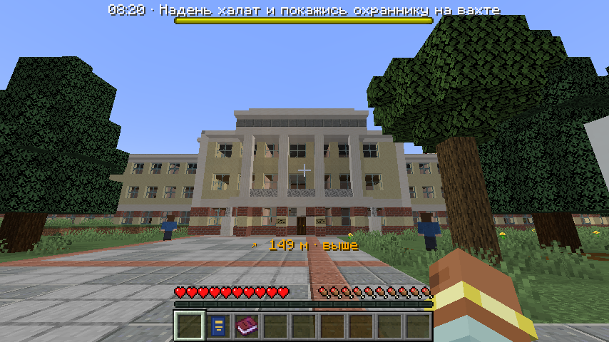
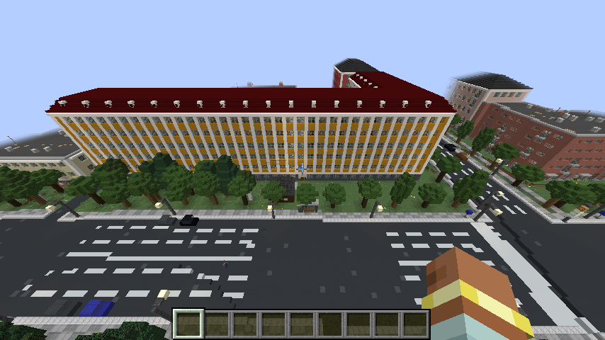
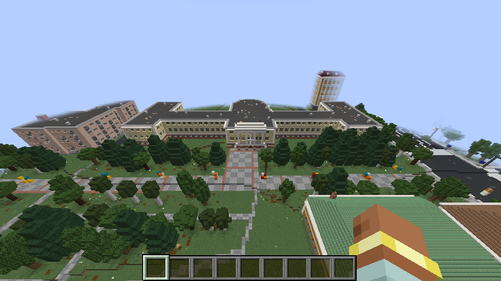
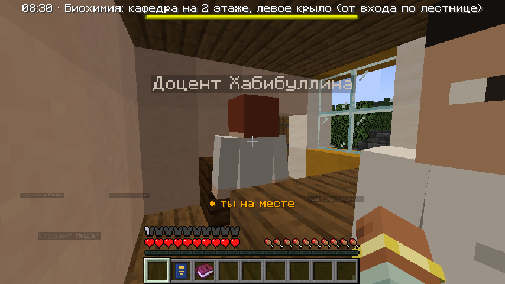
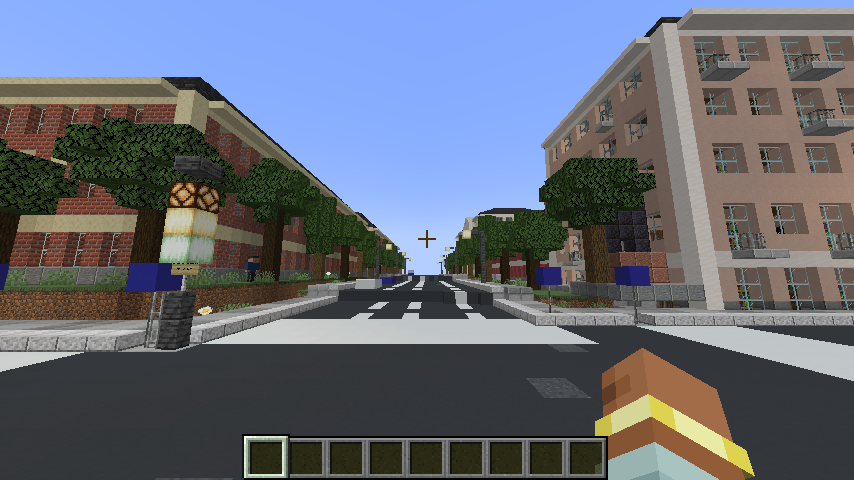
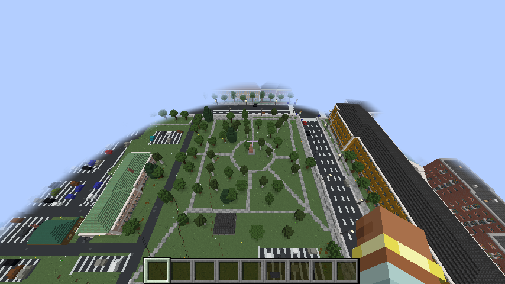
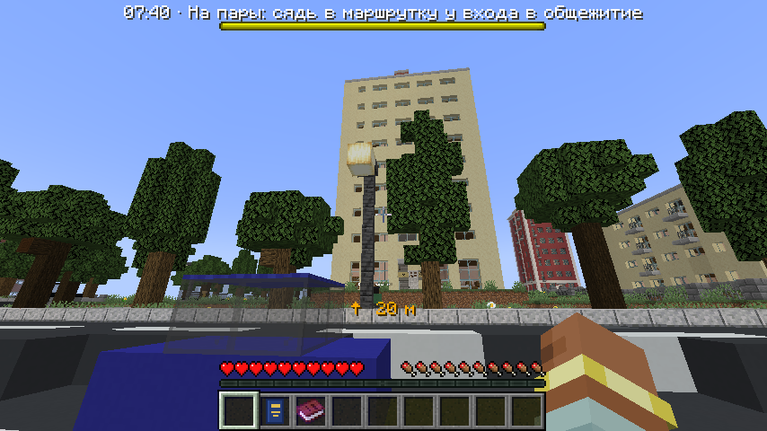
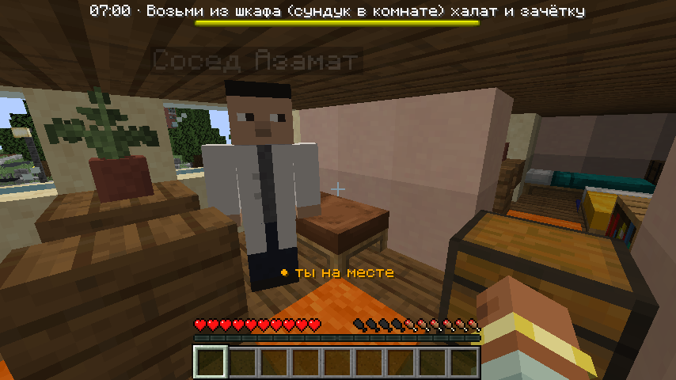
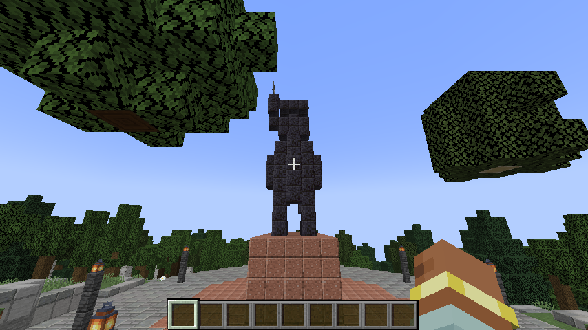
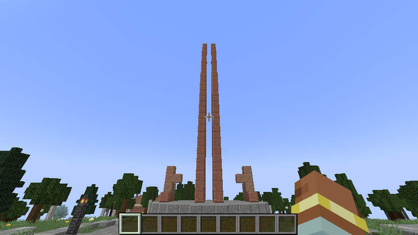

# Уфа: День экзамена

Сюжетный мод для **Minecraft 1.20.1 (Forge 47.x)**.

Ты — студент стоматологического факультета БГМУ. Утро, общежитие на Мингажева, будильник. Сегодня занятие по
биохимии и экзамен по анатомии. Сдашь — поедешь отмечать к памятнику Салавату Юлаеву. Не сдашь — у крыльца
кафедры тебя встретит военком с повесткой, дальше учебка и «Урал» у ворот.

## Что внутри

- **Центр Уфы в масштабе 1:1** (один блок — один метр) в отдельном измерении `ufamod:ufa`. Город построен по
  данным OpenStreetMap: около 5400 зданий с настоящими контурами, этажностью и адресами, реальный рельеф
  с обрывом к Белой, улицы, парки, скверы.
- **Улицы**: тротуары с бордюрами, разметка и «зебры» со знаками, трамвайные рельсы, заборы и подпорные стенки,
  деревья, фонари, светофоры, остановки с названиями, указатели на перекрёстках, киоски, памятники и фонтаны,
  припаркованные машины у обочин и на стоянках.
- **Здания**: фасады по эпохам (деревянные дома, купеческие особняки, сталинки, хрущёвки, панельные и
  современные дома, церкви и мечети), крыши, балконы, карнизы, таблички с адресами, вывески магазинов из
  карты.
- **Интерьеры в каждом здании**: подъезды с лестницами на все этажи, коридоры, комнаты с мебелью (жилые
  комнаты, кухни, классы, кабинеты, палаты, торговые залы).
- **Сюжет на реальных адресах**: общежитие БГМУ на ул. Мингажева, корпус №7 (ул. Пушкина, 96/98) с кафедрой
  биохимии на 2 этаже, кафедра анатомии в корпусе №4 (ул. Заки Валиди, 47), корпус №1 с колоннами
  (ул. Ленина, 3), столовая БГМУ, Национальная библиотека (ул. Ленина, 4), памятник Салавату Юлаеву,
  монумент Дружбы. Между общежитием и университетом почти два километра — ходит маршрутка до остановки
  «Дом актёра».
- **Университетский городок по реальным данным**: какие кафедры в каком корпусе и на каком этаже — с сайта
  БГМУ; внешний вид корпусов — по уличным панорамам (см. ниже).
- Говорящие NPC, экзамен из 5 случайных вопросов (всего 20), два финала.
- Предметы: белый халат, зачётка, повестка, эчпочмак, чак-чак, кумыс, камуфляж, сапёрная лопатка.

## Скриншоты

| | |
| --- | --- |
|  |  |
|  |  |
|  |  |
|  |  |
|  |  |

## Как играть

1. Установи [Forge для 1.20.1](https://files.minecraftforge.net/net/minecraftforge/forge/index_1.20.1.html)
   и положи готовый файл [`release/ufamod-1.2.0.jar`](release/ufamod-1.2.0.jar) в папку `mods`.
2. Создай **новый мир**. Minecraft один раз предупредит про «экспериментальные настройки мира» — это из-за
   собственного измерения, нажми «Продолжить». Миры от прошлой версии мода не подойдут.
3. Ты проснёшься в комнате общежития. Дальше — по заданиям вверху экрана; стрелка под прицелом показывает
   направление и расстояние до цели.

Подсказки:

- Халат и зачётка лежат в сундуке-«шкафу» в комнате, еда — во втором сундуке у двери.
- До университета далеко: у входа в общежитие стоит **водитель маршрутки** — поговори с ним (ПКМ).
- Халат нужно **надеть** (слот нагрудника), иначе охранник корпуса №7 не пустит.
- Кафедра биохимии — на 2 этаже, в левом крыле: от вахты по лестнице, на площадке висит указатель.
- Ответы на все вопросы экзамена есть в «Атласе анатомии»: он лежит в шкафу, а ещё на пюпитре
  в Национальной библиотеке напротив корпуса №1. Для «удовлетворительно» нужно 3 верных ответа из 5.

### Команды

| Команда | Что делает |
| --- | --- |
| `/ufa restart` | начать день заново |
| `/ufa free` | свободная прогулка по городу в творческом режиме |
| `/ufa tp <место>` | перемещение: `dorm`, `bsmu` (корпус №1), `k7`, `anatomy`, `library`, `gostiny`, `opera`, `park`, `artkvadrat`, `salavat`, `friendship`, `camp` |
| `/ufa leave` | вернуться в обычный мир (выживание) |
| `/ufa stage <стадия>` | перейти к стадии сюжета (нужны права оператора) |

## Что настоящее, а что условное

- **Настоящее**: расположение и контуры зданий, этажность (где она указана на карте), адреса, названия
  магазинов и учреждений, улицы и их ширина, рельеф, парки, остановки, памятники.
- **БГМУ — по открытым сведениям**. Поэтажных планов корпусов в открытом доступе нет, но на сайте
  университета у каждой кафедры указан адрес, корпус и этаж. По ним расставлены указатели на лестницах:
  - корпус №1 (ул. Ленина, 3) — «биокорпус», сдан в 1940 году;
  - корпус №2 (ул. Заки Валиди, 47) — микробиология и гигиена на 1 этаже, философия на 2-м;
  - корпус №4 (ул. Заки Валиди, 47) — кафедра анатомии человека с анатомическим музеем;
  - корпус №7 (ул. Пушкина, 96/98) — биохимия (2 этаж, левое крыло), фармакология (2 этаж), общая химия,
    медицинская физика и патофизиология (3 этаж), иностранные языки (6 этаж), научная библиотека.

  Сами комнаты, коридоры и лестницы внутри расставлены генератором: настоящая планировка неизвестна.
- **Облик сверен с панорамами улиц** для корпусов БГМУ №1, №2, №4 и №7, театра оперы и балета, Гостиного
  двора и Национальной библиотеки: цвет стен, цоколь, колонны и пилястры, крыша. У корпуса №1 повторён вход:
  четыре белых пилона над крыльцом, полосатый первый этаж, площадка перед аллеей скульптур. Остальные здания
  города получают фасад по типу, этажности и материалу.
- **Повёрнуто на 15°**: вся карта довёрнута так, чтобы улицы исторического центра (Ленина, Пушкина,
  Коммунистическая) шли ровно вдоль блоков. Поэтому «север» в игре отличается от настоящего на 15°.
- **Интерьеры придуманы**: планировка коридорная, с комнатами по обе стороны.
- **Машины стоят, а не ездят**; где именно они припаркованы — случайность, а не съёмка.
- В части зданий сложной формы на верхние этажи пока нельзя подняться по лестнице (около 10% многоэтажных
  домов). Сюжетные здания проверяются отдельно: путь от кровати до улицы пешком гарантирован.
- Все персонажи вымышленные.

## Данные и лицензии

Карта: © участники [OpenStreetMap](https://www.openstreetmap.org/copyright), лицензия ODbL.
Рельеф: открытые тайлы высот Mapzen/AWS Terrain Tiles (на основе SRTM и других открытых наборов).
Обработанные данные лежат в `src/main/resources/ufamod_city/`.
Сведения о корпусах и кафедрах БГМУ: сайт университета bashgmu.ru. Уличные панорамы использовались только
как образец для сверки облика зданий; в мод не входят.

## Сборка из исходников

Нужны JDK 17 (для мода) и JDK 25 + JDK 8 (их требует ForgeGradle 7; Gradle находит установленные сам).

```
./gradlew build          # готовый мод: build/libs/ufamod-1.2.0.jar
./gradlew runClient      # запустить игру с модом
```

Для разработки:

```
python3 tools/fetch_osm.py work && python3 tools/osm_to_city.py work   # заново собрать данные города из OSM
./gradlew runServer -PufaExit                          # сгенерировать все здания и проверить проходимость
./gradlew runClient -PufaAuto -PufaWorld=<имя мира>    # автопрохождение сюжета со скриншотами
python3 tools/gen_textures.py                          # перегенерировать текстуры
```

## Где что в коде

| Файл | Содержимое |
| --- | --- |
| `tools/osm_to_city.py` | OpenStreetMap + рельеф → слои города (высоты, покрытия, разметка, здания, объекты) |
| `city/CityData.java` | загрузка данных города |
| `worldgen/UfaChunkGenerator.java` | генератор чанков измерения |
| `worldgen/StreetPainter.java`, `StreetObjects.java` | улицы, покрытия, деревья, фонари, остановки, памятники |
| `building/BuildingGenerator.java` | здания: фасады, крыши, лестницы, планировка, мебель |
| `building/Style.java` | эпохи и материалы |
| `building/WalkTest.java` | проверка, что из здания можно выйти пешком |
| `world/Story.java`, `Places.java` | сюжетные здания и места |
| `world/Stamps.java`, `CampBuilder.java` | памятник Салавату, монумент Дружбы, учебный центр |
| `quest/QuestManager.java` | сюжет, диалоги, финалы |
| `quest/ExamQuestions.java` | вопросы экзамена |
